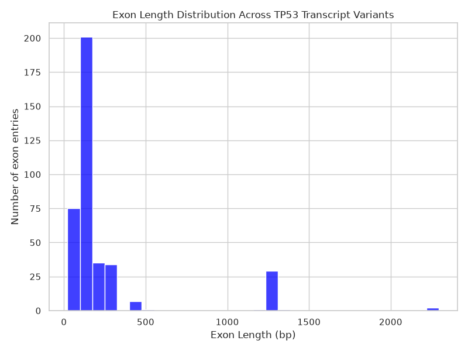
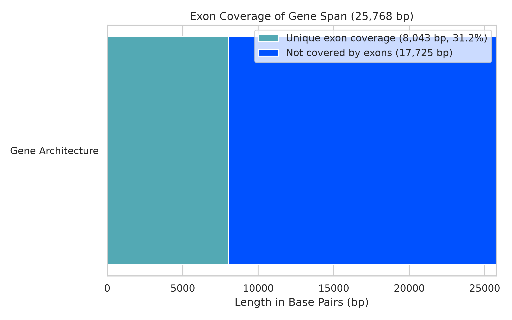

# Analysis Report

## Workflow

## Findings

## Interpritations

## Figure 1 - Distrabution of Exon Lengths

> This graph shows the lengths of all exons within the gene span.

## Figure 2 - Exon Coverage of Gene Span

> This graph shows how much of the gene span is deticated to genetic exon code.